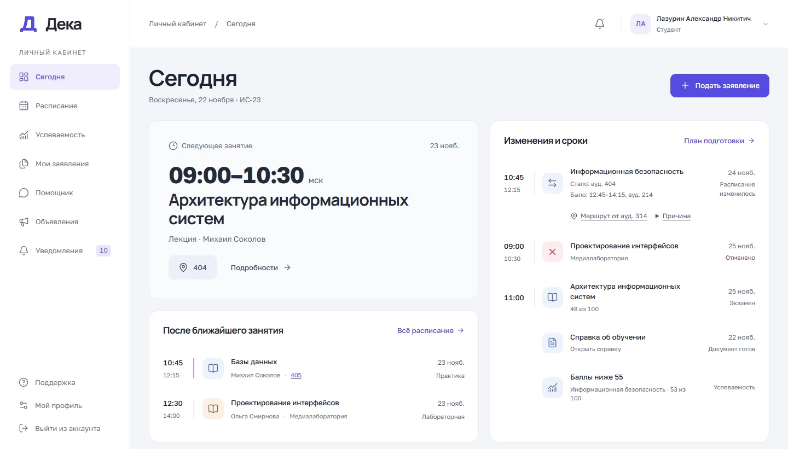
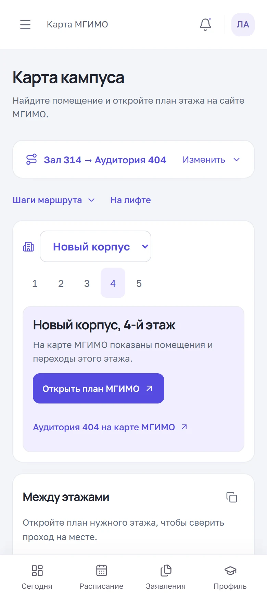
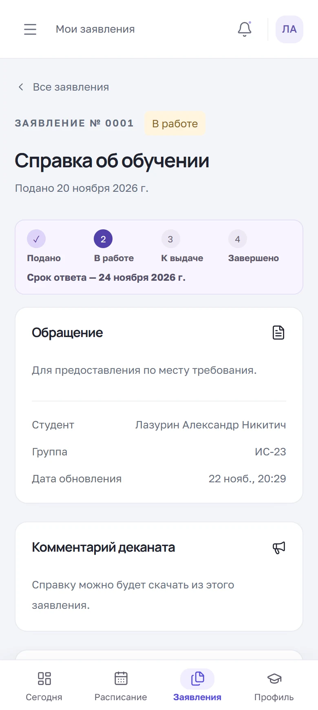

<p align="center">
  
</p>

<h1 align="center">Дека</h1>

<p align="center">Личный кабинет студента и рабочее место деканата.</p>

<p align="center">
  <a href="#что-работает">Возможности</a> ·
  <a href="#запуск">Запуск</a> ·
  <a href="site">Витрина для GitHub Pages</a> ·
  <a href="docs/contest/demo-guide.md">Маршрут для жюри</a> ·
  <a href="#проверки">Проверки</a>
</p>

<p align="center">
  <a href="site/assets/screenshots/today-desktop.webp">
    
  </a>
</p>

## Что работает

- **Перенос пары.** Уведомление открывает занятие с прежним и новым временем, причиной переноса и ссылкой на план МГИМО. Ссылка на занятие продолжает работать после повторного переноса.
- **Справка.** Студент подаёт заявление, видит срок и отвечает на уточнение в карточке. Деканат видит просроченные заявки в начале очереди и выдаёт документ с QR для проверки.
- **Учёба.** Расписание на неделю, экспорт в календарь, оценки, зачёты, посещаемость и напоминания об аттестациях. Преподаватель и деканат ведут учебные записи в пределах своих полномочий.

<p align="center">
  <a href="site/assets/screenshots/campus-mobile.webp">
    
  </a>
  &nbsp;
  <a href="site/assets/screenshots/request-status-mobile.webp">
    
  </a>
</p>

## Запуск

Для Windows нужны PowerShell 7, Node.js 24.22.3 или 26.13.1 и PostgreSQL 18. Запустите команды из корня новой копии проекта.

```powershell
pwsh -NoProfile -ExecutionPolicy Bypass -File ./scripts/manage.ps1 setup
pwsh -NoProfile -ExecutionPolicy Bypass -File ./scripts/manage.ps1 migrate
pwsh -NoProfile -ExecutionPolicy Bypass -File ./scripts/manage.ps1 seed
pwsh -NoProfile -ExecutionPolicy Bypass -File ./scripts/manage.ps1 start -WithoutAssistant
```

Откройте [127.0.0.1:5180](http://127.0.0.1:5180/login) и выберите пользователя на странице входа. База создаётся в `.local/`. Сценарий `seed` наполняет пустую базу вымышленными данными.

<details>
<summary>Запуск с Docker Compose</summary>

```powershell
pwsh -NoProfile -ExecutionPolicy Bypass -File ./scripts/manage.ps1 docker-demo -WithoutAssistant
```

После запуска откройте [localhost:5180](http://localhost:5180/login). [Подробности развёртывания](docs/deployment.md)

</details>

В [`site/`](site) лежит отдельная витрина с тремя интерактивными примерами. Её можно открыть без базы и входа. [Локальный просмотр и публикация](docs/deployment.md#витрина-на-github-pages)

## Проверки

| Что измеряли | Результат |
| --- | ---: |
| Автоматические тесты Node.js 24 и 26 | 57 |
| Контрольная ширина мобильных сценариев | 360 px |
| p95 приложения при 32 одновременных запросах | 67,5 мс |
| Ответы в основном прогоне | 6 480 · 0 ошибок |
| 64 разные студенческие сессии | 834 ответа/с · 88,03 мс p95 |

Замер от 22 ноября 2026 года. Windows, Node.js 26.13.1 и PostgreSQL 18.7. Шесть авторизованных SSR-страниц по loopback. [Методика и результаты](docs/verification.md) · [Техническое описание (PDF)](docs/contest/technical-overview.pdf) · [Описание процесса создания (PDF)](docs/contest/process-description.pdf)

```sh
npm run check
npm test
```

Для `npm test` нужна локальная демонстрационная конфигурация. Прогон создаёт отдельную временную базу.

## Код

SvelteKit и TypeScript, серверный рендеринг на Node.js, PostgreSQL. База хранит учебные данные и историю операций. Сервер проверяет доступ к каждой записи. [Архитектура](docs/architecture.md) · [Безопасность](docs/security.md) · [Иконки и размер сборки](docs/icons.md)

| Путь | Содержимое |
| --- | --- |
| [`src/`](src) | Маршруты, интерфейс и серверные модули |
| [`static/`](static) | Шрифты, знак и ресурсы кабинета |
| [`db/migrations/`](db/migrations) | Схема и права PostgreSQL |
| [`tests/`](tests) | Проверки сервера и сквозные сценарии |
| [`scripts/`](scripts) · [`deploy/`](deploy) | Команды разработки и конфигурация развёртывания |
| [`site/`](site) · [`docs/`](docs) | Витрина, документация и материалы для жюри |

Дека — независимый проект для номинации «Цифровой деканат». Все записи в демонстрационной базе вымышлены. [Лицензия](LICENSE) · [Сторонние материалы](docs/assets/licenses.md)