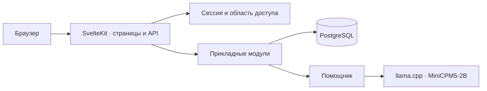

# Архитектура Деки

Приложение развёртывается одним веб-сервером с PostgreSQL. Помощник обращается к отдельному серверу модели. Браузер получает интерфейс и данные, доступные его сессии.

Минимальная поддерживаемая версия — Node.js 24.22.3. Типы ограничены API Node 24. Compose использует 26 по умолчанию. [Сравнение версий](verification.md#nodejs-24-и-26)

## Разделение кода

| Путь | Что здесь живёт |
| --- | --- |
| `src/routes` | Маршруты, параметры, формы и HTTP-статусы. |
| `src/lib/modules` | Контракты, правила, серверные операции и компоненты отдельных сценариев. |
| `src/lib/application` | Оболочка, стили и навигация приложения. |
| `src/lib/shared` | Форматирование, валидация и общие UI-компоненты. |
| `src/lib/server` | Подключение к PostgreSQL и криптография. |
| `src/service-worker`, `static` | Установка PWA, кеш разрешённой статики, шрифты и ресурсы. |
| `tests`, `scripts` | Unit и integration, проверки браузера, миграции, seed и бенчмарки. |
| `db/migrations` | Очерёдность изменений схемы и привилегий. |
| `deploy` | Docker, нативный запуск на Windows и серверные зависимости. |
| `docs/contest`, `docs/features`, `docs/assets` | Конкурсные материалы, описание функций и лицензии. |
| `site` | Статическая витрина и снимки интерфейса. |
| `docs/benchmarks`, `docs/archive` | Замеры выпуска и исторические материалы. |
| `.local/` | База, окружение, модель, отчёты и архивы установки. |

## Владельцы сценариев

| Модуль | Ответственность |
| --- | --- |
| `overview` | «Сегодня» для студента и обзор сотрудников. Собирает краткие данные из других модулей. |
| `cabinet` | Профиль студента, навигация профиля и карточки учебных сервисов. |
| `academics`, `study-plan` | Расписание, оценки, посещаемость, импорт, календарь и подготовка к аттестациям. |
| `requests` | Шаблоны, валидация, переходы, переписка, документы и проверка реестра. |
| `auth`, `administration` | Сессия, роль, реестр и журнал действий. |
| `announcements`, `notifications` | Объявления факультета, адресные события и отметки о прочтении. |
| `assistant` | Чаты, доступный контекст, серверные ответы по данным и опциональная модель. |
| `campus`, `student-cards` | Поэтажные схемы, маршруты, QR и проверка студенческого. |

## Соглашения

- Папки и обычные файлы используют `kebab-case`. Компоненты Svelte используют `PascalCase`. Файлы маршрутов следуют соглашениям SvelteKit.
- `*.types.ts` хранит контракты, `*.policy.ts` правила, `*.labels.ts` подписи и шаблоны. В `server/` файлы имеют суффикс `.server.ts`, репозитории выполняют SQL, сервисы координируют операции и транзакции.
- Маршрут загружает текущую сессию, валидирует параметры и обращается к модулю. Прикладные операции ограничивают чтение и запись по владельцу, группе, назначению или факультету. Общий UI не импортирует прикладные модули.
- Учебные записи и заявки обновляются с проверкой версии. История, уведомление и аудит записываются в той же транзакции. Повторная отправка формы использует тот же идентификатор операции.
- Применённые миграции сохраняют контрольную сумму. Новые изменения добавляются следующим SQL-файлом. Демонстрационное наполнение запускается явно.
- Скриншоты для документации лежат в `docs/assets/screenshots`. База, секреты, сборка и веса модели остаются за пределами исходного архива.

## Два потока

**Расписание.** Деканат указывает причину переноса при редактировании. Сервер проверяет группу, преподавателя и аудиторию, сохраняет предыдущий слот и отправляет уведомление. Ссылка содержит идентификатор занятия. Сервер проверяет роль и открывает его актуальную неделю, в том числе за рамками обычного расписания. Старые уведомления с датой открываются по тому же правилу. Маршрут начинается от предыдущей пары в тот же день или от главного входа, если исходной аудитории нет в справочнике.

**Заявление.** Сервер открывает заявку владельцу и деканату его факультета. Сотрудник указывает срок и запрашивает уточнение. Пока нужен ответ, выдача справки недоступна. Ответ студента, снятие ожидания, история и уведомление записываются в одной транзакции. Повторная отправка того же сообщения не создаёт дубль. Сроки сравниваются по московской дате. Заявки, где ждут студента, не считаются просроченными в очереди деканата.

[Безопасность](security.md) · [Проверка и замеры](verification.md) · [Развёртывание](deployment.md)

